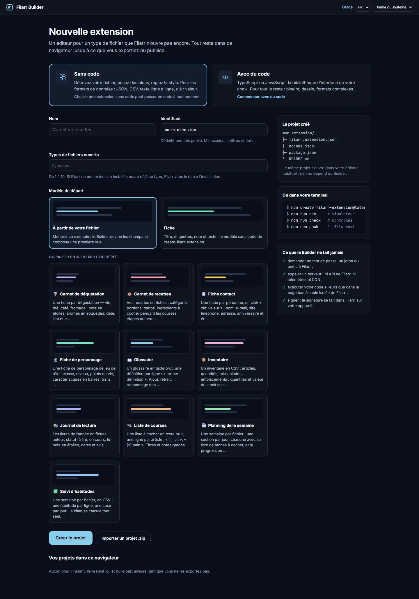
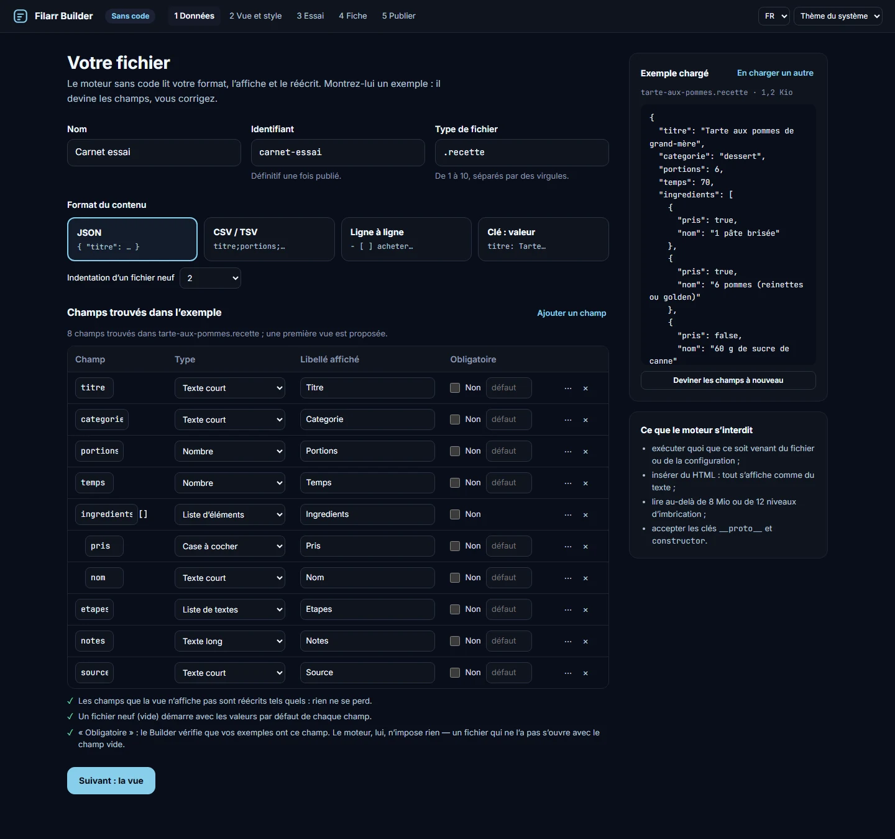
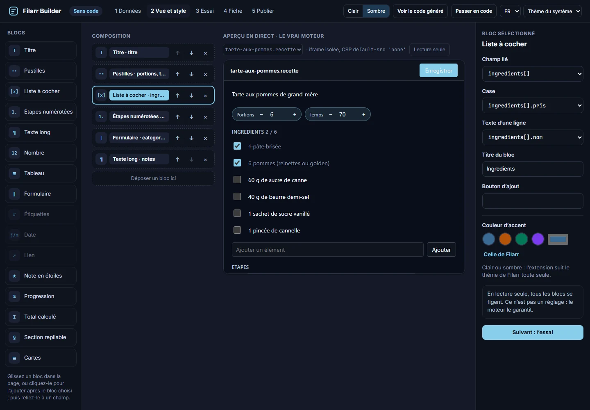
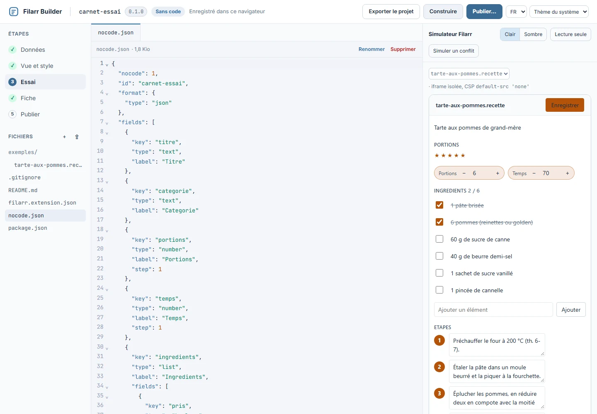
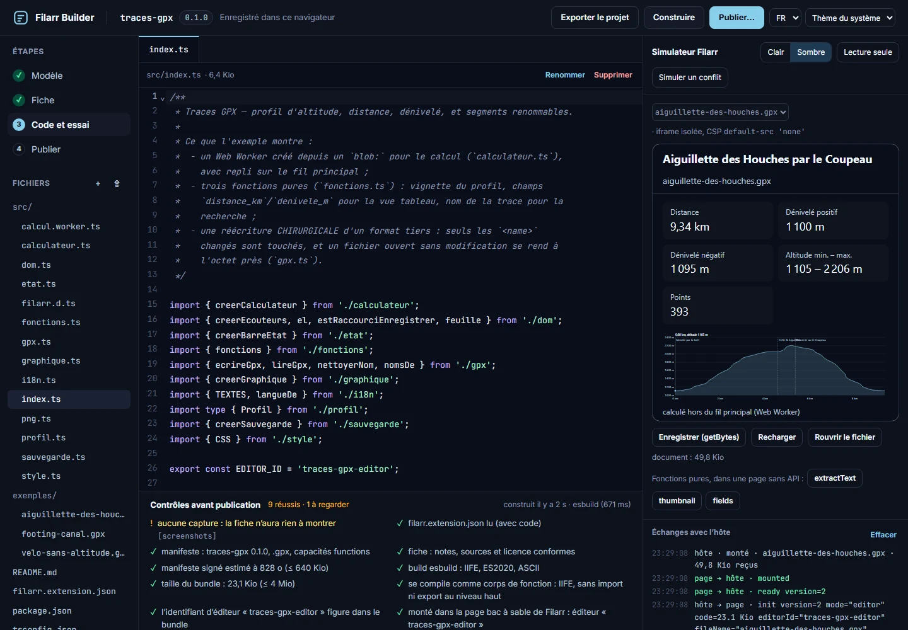
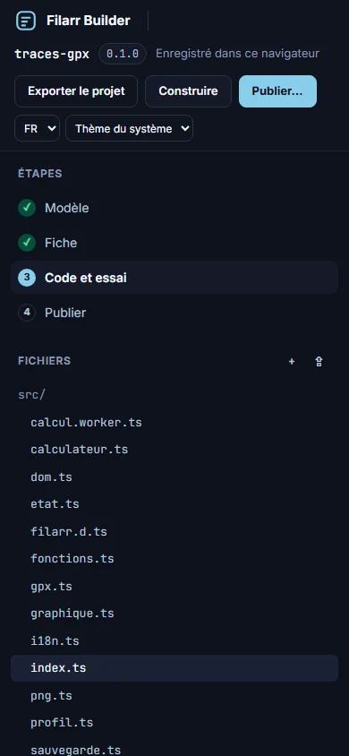
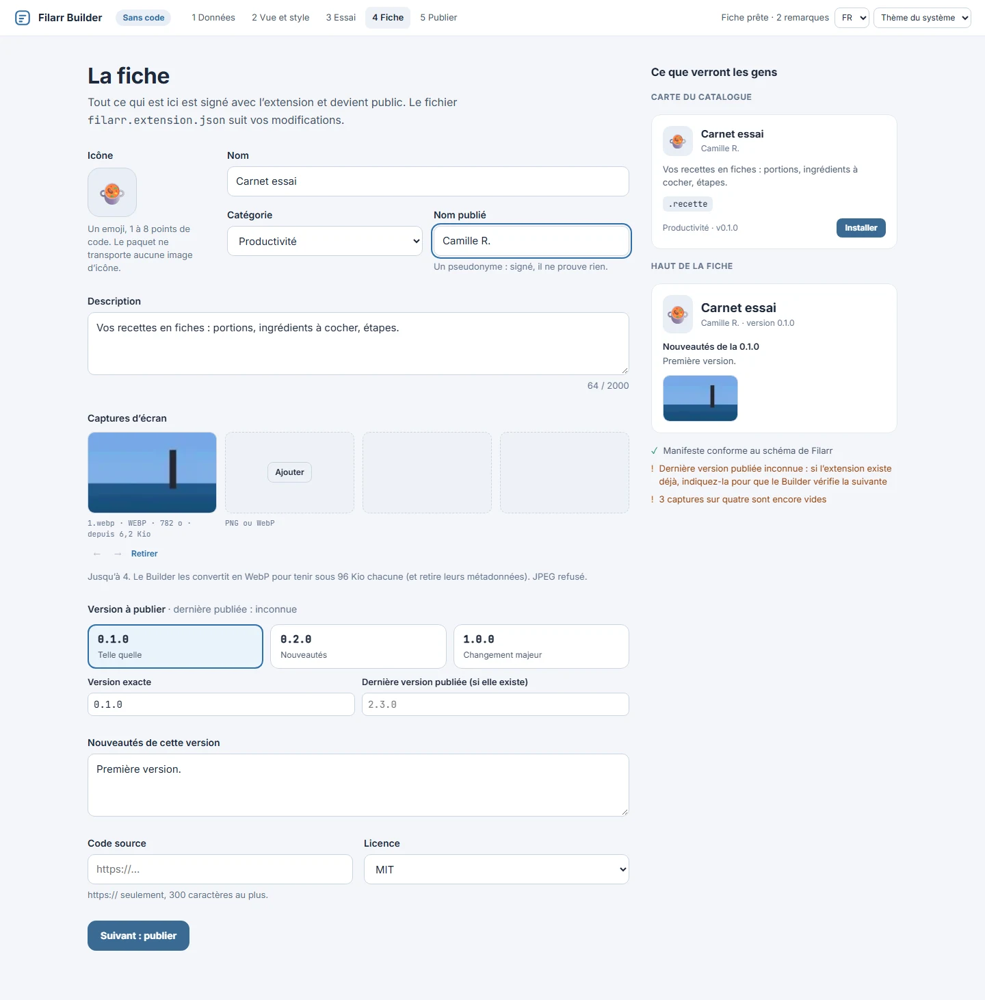

# Filarr Builder, l'atelier dans le navigateur

Filarr Builder (`apps/builder`) compose une extension Filarr sans rien installer :
sans code, à la souris, ou avec du code, dans un éditeur. Il construit le bundle,
passe les contrôles de `filarr-ext check`, fabrique le paquet `.filarrext` et le remet
à Filarr. Il ne signe jamais : la signature se fait dans Filarr, sur votre appareil.

L'atelier n'est pas encore en ligne. Pour le lancer depuis un clone de ce dépôt :

```bash
npm install
npm run dev -w @filarr/builder        # http://localhost:5173
npm run build -w @filarr/builder      # apps/builder/dist, avec _headers et la CSP
```

Le port 5173 est celui qu'accepte un Filarr de développement pour la remise d'un paquet.

## Ce que l'atelier ne fait jamais

- Il ne demande ni mot de passe, ni jeton, ni clé Filarr.
- Il n'appelle aucun serveur : ni l'API de Filarr, ni télémétrie, ni CDN. Les polices et
  le compilateur (esbuild-wasm) sont embarqués.
- Votre code ne s'exécute que dans une iframe `sandbox="allow-scripts"`, sur la page bac à
  sable de Filarr (la même, octet pour octet, servie avec ses en-têtes).
- L'atelier lui-même tourne sous une CSP sans `unsafe-eval` : seul `wasm-unsafe-eval`, pour
  esbuild. La syntaxe du bundle y est vérifiée par un analyseur (acorn), pas par
  `new Function`.
- Les projets restent dans ce navigateur (IndexedDB) tant que vous ne les exportez pas.

## Nouvelle extension

Sans code ou avec du code, le nom, l'identifiant (déduit du nom, définitif une fois
publié), les types de fichiers ouverts, puis un modèle de départ : celui de
`create-filarr-extension`, un modèle vierge, ou l'un des vingt exemples du dépôt. Un
projet `.zip` exporté s'importe ici, avec la même arborescence que
`create-filarr-extension`.



## Sans code

Cinq étapes : **Données**, **Vue et style**, **Essai**, **Fiche**, **Publier**.

**Données** : le format (JSON, CSV/TSV, ligne à ligne, `clé: valeur`) et ses options.
Chargez un fichier d'exemple : l'atelier devine les champs, vous corrigez le type, le
libellé, la valeur par défaut et les sous-champs. Ce qui n'est pas affiché est réécrit tel
quel.



**Vue et style** : les seize blocs du moteur, composés par clic ou glisser-déposer (au
clavier aussi), avec leurs vraies options et une couleur d'accent. L'aperçu est le vrai
moteur, dans la page bac à sable, en clair ou en sombre. **Voir le code généré** montre la
configuration, et **Passer en code** fait d'un projet sans code un projet avec code.




**Essai** : le simulateur de Filarr, avec le thème, la lecture seule, un conflit simulé et
le journal des échanges avec l'hôte. Il est rechargé à chaque construction.



## Avec du code

Quatre étapes : **Modèle**, **Fiche**, **Code et essai**, **Publier**. L'arbre des
fichiers, des onglets et CodeMirror ; la construction se fait dans le navigateur
(esbuild-wasm, la convention `?worker` comprise). Les **Contrôles avant publication** sont
ceux de `filarr-ext check`, et le simulateur appelle aussi les fonctions pures
(`extractText`, `thumbnail`, `fields`) dans une page sans API.



L'atelier reste utilisable à 390 px de large et au clavier.



## La fiche

Icône (un emoji : le paquet ne transporte pas d'image d'icône), nom, catégorie, nom
publié, description, jusqu'à quatre captures (PNG ou WebP, JPEG refusé, réencodées en
WebP de 96 Kio au plus), version, nouveautés, lien `https://` vers le code source,
licence. À droite, la carte du catalogue et le haut de la fiche tels que les verront les
gens.



## Publier

Construire, vérifier (dont un vrai montage dans la page bac à sable), empaqueter, puis
remettre le paquet à Filarr :

- **Ouvrir dans Filarr** : Filarr s'ouvre dans un nouvel onglet, sur Publier, et reçoit le
  paquet de ce seul atelier (`PACKAGE.md` §5 du dépôt de Filarr) ;
- **Télécharger le paquet**, à déposer dans Place de marché → Publier ;
- `npx filarr-ext publish <paquet>` depuis le terminal, pour l'application de bureau.

Dans Filarr, vous relisez tout ce qui deviendra public, puis Filarr signe sur votre
appareil.


## Ce qui reste hors de l'atelier

- Preact, Svelte et Lit : rien ne se télécharge, seuls `@filarr/extension-api`,
  `@filarr/nocode-engine` et `yjs` sont embarqués.
- La capacité `network` : le simulateur n'a pas de relais, il renvoie vers
  `filarr-ext dev`.
- Les messages des contrôles sont en français, même en anglais : ils viennent des paquets.

## Tests

```bash
npm test -w @filarr/builder           # vitest : bundles et paquets identiques à filarr-ext
npm run test:e2e -w @filarr/builder   # Chromium, sur le site construit et sa CSP
```

Si Windows réserve la plage de ports par défaut (écoute refusée en `EACCES`),
`BUILDER_E2E_PORT` et `BUILDER_E2E_FAKE_PORT` choisissent d'autres ports.
