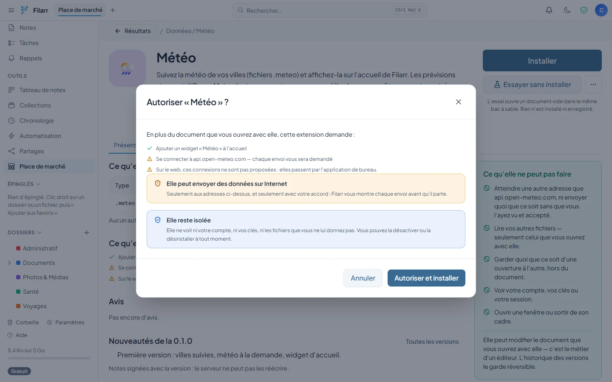
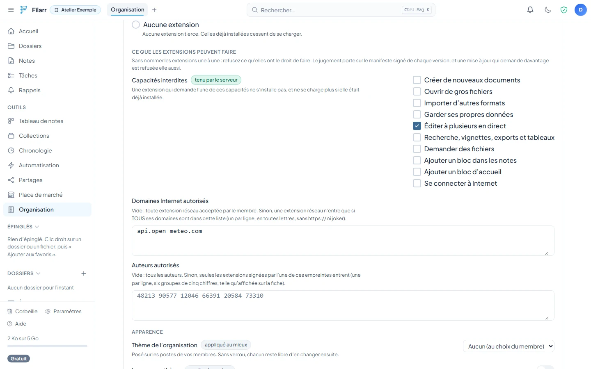
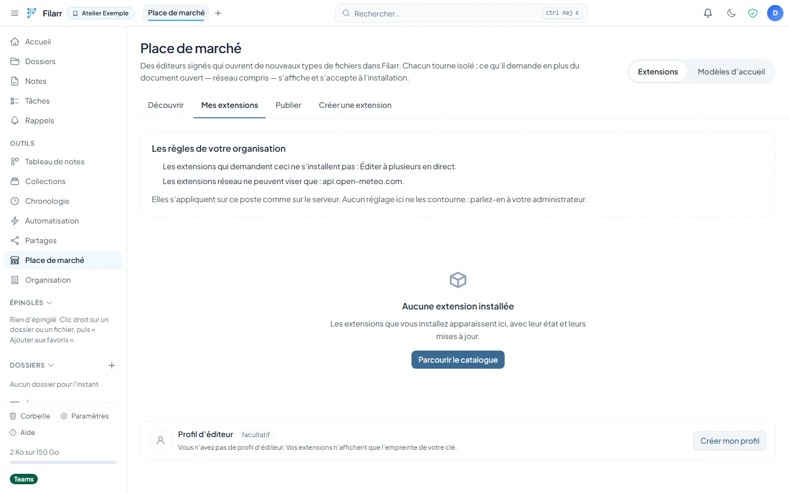
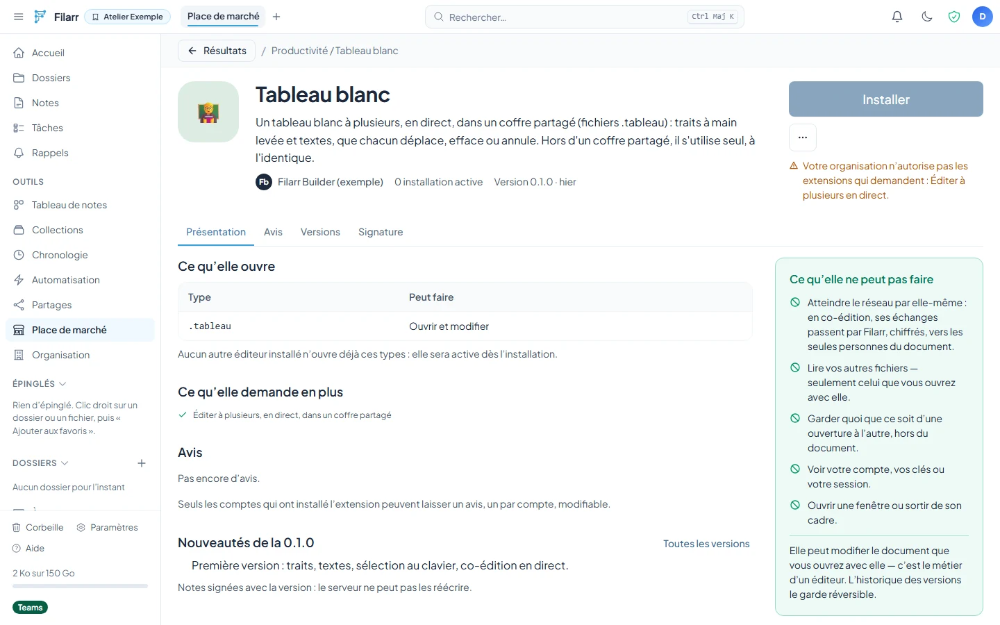

# Extension capabilities — contract frozen on October 23, 2026

This contract extends [the extension API](API.md) in four tiers, without removing anything: an extension published before it remains valid, and verifies and loads exactly as before. It was frozen BEFORE the code; any drift is corrected here first.

## The two rules

1. **The extension never chooses what it sees.** Filarr passes it data: the open document, what the user chose in a picker drawn by Filarr, or a file Filarr chose for a pure function. There is no “read all notes” capability.
2. **Read, or talk to the Internet: never both without the user.** An extension that declares `network` gets no picker, no storage and no functions on other files; every outgoing request goes through a Filarr confirmation that shows its content.

These rules are enforced by the HOST (the bridge, the registry, the validator), never by the extension's good faith. The sandbox does not change: a `sandbox="allow-scripts"` iframe with an opaque origin, a `default-src 'none'` CSP whose `script-src` admits only the page's script, WebRTC constructors removed (Chromium ignores the `webrtc` directive).

## The signed `capabilities` field

Optional, in the signed manifest (`MarketplaceManifest`). Absent = the extension as it has always been. CLOSED list: an unknown key is refused at publish (`bad_manifest`); at install, an app that does not know a key does not enable the extension (status `needs_update`) instead of running it without what it expects.

A single validator in Filarr (`extensionCapabilities.ts`), ported identically into the worker by a port script (`plugin-core-port.cjs`) — the same rule as for the layout core.

```ts
capabilities?: {
  // Tier 1 — no additional data access
  newDocument?: { ext: string; label: string; seed?: string }[]; // 1–4; seed: base64, ≤ 64 KiB decoded; ext ∈ extensions
  maxBytes?: number;                    // 1 … 64 MiB; default: the core's ceiling
  imports?: string[];                   // 1–10, file-extension form, disjoint from `extensions`
  storage?: { quota: number };          // 1 KiB … 16 MiB
  collab?: true;                        // live co-editing (Yjs relay), see “Tier 1b”
  // Tier 2 — pure functions
  functions?: {
    extractText?: true;
    thumbnail?: true;
    fields?: { key: string; label: string; type: 'text' | 'number' | 'date' | 'checkbox' | 'url' }[]; // 1–32
    exports?: { to: 'md' | 'txt' | 'html' | 'csv' | 'json'; label: string }[];                       // 1–4
  };
  // Tier 3 — seeing more, through Filarr
  picker?: { access: 'read' | 'readwrite'; extensions?: string[] };
  noteBlock?: { label: string };
  homeWidget?: { label: string };
  // Tier 4 — Internet
  network?: { domains: string[]; secrets?: { id: string; label: string; header: string }[] };
}
```

Common bounds: `label` 1–60 code points, with no invisible or bidirectional characters; `key`/`id` `^[a-z][a-z0-9_]{0,31}$`; `domains` 1–8 exact hosts in lowercase (no wildcard, no IP address, no port), HTTPS implied; `header` one of `authorization`, `x-api-key` or `^x-[a-z0-9-]{1,40}$`; 1–4 secrets.

**Exclusion checked by the validator**: `network` is refused together with `picker`, `storage`, `functions` or `noteBlock` (`network_exclusive`).

## Consent

- Consent is the SHA-256 fingerprint of the canonical JSON of `capabilities`, stored with the installed extension. Empty (absent) capabilities ask for nothing.
- Installing an extension that declares capabilities shows their list in plain language before installation.
- An update whose fingerprint differs does not install by itself: `capabilities_changed`, then explicit confirmation (the same gesture as for a key change).
- Granted permissions = signed capabilities ∩ consent ∩ organization policy (see “Organization rules” below).



## Bridge protocol, version 2

`SANDBOX_PROTOCOL_VERSION = 2`. The guest page and the host ship together; there is no v1 compatibility to maintain.

`init` additionally receives:

- `mode`: `'editor' | 'function' | 'block' | 'widget'`;
- `grants`: the GRANTED capabilities (a subset of the manifest), the guest page's only source of truth;
- `theme`: `{ scheme: 'light' | 'dark', tokens: Record<string, string> }`, ≤ 64 tokens, names `^--[a-z0-9-]{1,48}$`, values ≤ 80 characters without `;{}<>` — set as CSS variables on `#plugin-root`;
- `locale`: the interface language (`fr`, `en`).

Guest → host requests: `{kind: 'request', requestId, op, …}`, response `{kind: 'response', requestId, ok, value | error}`. All are validated by the host's protocol parser (`sandboxProtocol.ts`), rate-limited (burst of 40, 20 per second, 16 in flight), and refused if the capability is not granted (`capability_denied`, counted as an invalid message):

| `op`                                                                                       | Tier | Returned value                           |
| ------------------------------------------------------------------------------------------ | ---- | ---------------------------------------- |
| `storage-get {key}` / `storage-set {key, bytes}` / `storage-delete {key}` / `storage-list` | 1    | bytes or `null` / `null` / `null` / keys |
| `pick {multiple}`                                                                          | 3    | `{handle, name}[]`                       |
| `picked-read {handle}` / `picked-write {handle, bytes}`                                    | 3    | bytes / `null`                           |
| `net-request {method, url, headers, body}`                                                 | 4    | `{status, contentType, body}`            |

On the page side, these requests are APIs that exist ONLY if the capability is granted: `host.storage.{get,set,delete,keys}`, `host.pick`, `host.readPicked`, `host.writePicked` (`readwrite` access), `host.network.request`.

Host → guest, `function` mode: `call {requestId, fn, fileName, bytes, to?}`; response `call-result {requestId, ok, value}`.

Limits: storage keys `^[a-z0-9._-]{1,64}$`, 256 keys; `extractText` ≤ 100,000 characters; thumbnail in PNG, JPEG or WebP, checked by its header bytes, ≤ 96 KiB; `fields` must match the declared schema (text ≤ 500 characters); export ≤ 64 MiB; network body ≤ 1 MiB in each direction.

The bundle declares its functions next to its editors:

```js
globalThis.filarrSandboxedPlugin = {
  editors: [
    {
      id: 'mon-format-editor',
      mount(host) {
        /* … */
      },
    },
  ],
  functions: {
    extractText(bytes, ctx) {},
    thumbnail(bytes, ctx) {},
    fields(bytes, ctx) {},
    export(bytes, ctx) {},
  },
  block: { mount(host) {} },
  widget: { mount(host) {} },
};
```

## Tier 1 — more power, no additional access

- **Performance.** The guest page's CSP adds `worker-src blob:` and `media-src blob: data:`: a worker created from a `blob:` inherits the page's CSP (no network). WebAssembly already works through `'unsafe-eval'`. Verified in Chromium by an end-to-end test in Filarr (`pluginSandbox.spec.ts`).
- **`newDocument`, `maxBytes`, `imports`**: wired to the registry's existing fields (`EditorContribution`).
- **Theme and language**: `host.theme` (`scheme`, `tokens`), `host.onThemeChange(cb)`, `host.locale`; the `SANDBOX_THEME_TOKENS` variables (`sandboxTheme.ts`) are set on `#plugin-root` and follow theme changes.
- **`host.storage`**: `get/set/delete/keys`, bytes. Stored by the host in a dedicated IndexedDB, AES-256-GCM with one key per account and per extension (HKDF-SHA256 from the account's encryption key, domain `filarr.extension.storage.v1`), with the entry's storage key bound in the AAD; LOCAL to the device (no sync in this contract), erased on uninstall. Locked account: `storage_locked`.

### Tier 1b — co-editing (`collab`)

The relay from the [COLLAB-DESIGN.md](COLLAB-DESIGN.md) design: opaque Yjs updates in both directions; the host keeps the key, the token and the epoch. Conditions for turning it on, all required: an update that touches a reserved root (`content`, `filarr:room`, `filarr:comments`) is refused; 1 MiB per sent frame, 8 MiB received; capability shown at consent.

Shipped on 2026-10-23. The extension's updates are never applied to the room document: the host stores them as-is in ITS root `filarr:ext:<identifier>` (a `Y.Array` of bytes, in Filarr's `extensionCollab.ts`) — so a reserved root cannot be touched. The page keeps its own `Y.Doc`; protocol: `init.collab { seed, responsible, updates }`, `collab-send` (page → host), `collab-update` and `collab-state` (host → page), `collab-seeded` (once). Rate: 60 updates/s (burst 120), 2 MiB/s (burst 8 MiB); beyond that, the bridge cuts off (`sandbox_collab_abuse`). Election, presence and transport remain the host's. A room only opens with the capability granted and a document of 5 MiB at most. Mobile does not open these documents (it does not run extensions): the `filarr:ext:*` root does not concern it.

## Tier 2 — pure functions

Filarr calls the functions on files IT chooses, in a guest page in `function` mode: no `storage`, no `picker`, no `network`, no visible DOM. A page serves one batch and is then destroyed; 10 s per call.

- `extractText` feeds local search;
- `thumbnail` feeds the thumbnails on file cards;
- `fields` feeds a table view built BY FILARR over the files of a folder (the extension never sees the whole set);
- `exports` adds “Export as …” to the file menu; Filarr saves the result wherever the user chooses.

## Tier 3 — seeing more, through Filarr

- **Picker**: `host.pick()` opens Filarr's picker; only the chosen items become accessible, through opaque handles valid for the session (never an `itemId`). `readwrite` allows `picked-write`, saved by the host with its usual guards.
- **Block in notes**: a SINGLE generic node type, `filarrExtensionBlock` (in Filarr, `extensionBlockExtension.ts`), a block atom. Its HTML form is FROZEN, byte for byte (test `extensionBlock.vitest.ts`):

  ```html
  <div data-extension="<identifier>" data-payload="<base64>" data-filarr-extension-block=""></div>
  ```

  `extension` follows the form of an extension identifier (`^[a-z][a-z0-9-]{1,63}$`, otherwise empty); `data` is base64 of at most 256 KiB once decoded (otherwise empty). The guest page (`block` mode) receives this data, and “save” writes it back into the node — the note encrypts and syncs it like everything else. Without the extension, the block stays intact and shows as an “extension not installed” frame. Exports write a named trace (“Extension block: <identifier>”). ⚠ Mandatory order: mobile must know this node (and keep it) BEFORE desktop allows inserting one — `EXTENSION_BLOCK_INSERTION_OPEN` stays `false` until then, and no menu calls `insertExtensionBlock`.

- **Home widget**: a generic `extension` type in the block registry, role `summary`, bounds `minW 2 · minH 2`, default 4×3, `minAppVersion` 3.10.0. Options: `extension` (identifier) and `config` (text, 240 characters at most — the limit of a layout option string). The guest page (`widget` mode) receives `config` as UTF-8, read-only: a block never rewrites the layout outside customization mode; whatever it needs to keep goes in its storage. The block catalogue is a contract with the phone app (Filarr's internal contract `accueil-blocs-2`, C0, test vectors `widget-registry.json`): the type has been in the registry since 2026-10-23, at the end of the table, after it shipped on mobile (inert tile, never offered on the phone).

## Tier 4 — Internet

- Requests go through the host's relay, never through the Filarr server: on desktop, the main process (`extensionNetwork.ts`, channel `extensionNet:request`), with the same guards as custom sources (`sourcesPerso.ts`: public addresses at every hop, 8 s, 1 MiB); on the web, not in this contract (the app's CSP is not widened; no service is wired, the request returns `unavailable`, and the listing page says so before installation).
- Domain not on the list (EXACT host comparison; subdomains are refused too), scheme other than HTTPS, explicit port, credentials in the URL, IP literal, local or Filarr host: refused without any request being made. A redirect stays on the starting ORIGIN, as GET, two hops at most (stricter than “on the list”: a secret never follows another host).
- Every request is confirmed by the user (`ExtensionNetworkHost`), with its content shown: method, full URL, headers, body (text, or its size if binary), added secrets (labels and presence). An IDENTICAL request (method, URL, headers, body) already accepted during the session goes through without asking again. “Block for this session” refuses everything the extension asks for until the end of the session. At most four pending requests per extension (`busy`). Cookies are never sent or kept (`credentials: 'omit'`, `cookie` and `set-cookie` stripped on every pass), no cache.
- Extension headers: lowercase names, the custom sources' blocklist (`host`, `cookie`, `origin`, `referer`, `user-agent`, `sec-*`, `proxy-*`…), and never the header of a declared secret. No body on a GET.
- The response returns the status as-is (a 404 is a response), only the `content-type`, and 1 MiB of bytes at most (`net_too_large`). Refusal codes: `net_invalid`, `net_domain`, `net_header`, `net_refused`, `net_redirect`, `net_unreachable`, `net_too_large`, `busy`, `unavailable`.
- A secret's value is placed AS-IS in the declared header: for an `authorization` header, the user enters the full value (“Bearer …”) — the secret's label must tell them so.
- Secrets are entered in Filarr (“My extensions” › Secrets), sent ONCE to the main process, which seals them with `safeStorage` (`extensionSecrets.ts`, per account and per extension), and added by the relay to the declared header; neither the renderer nor the extension sees them afterwards (the renderer only knows “present”). Without a system keychain, nothing is saved. They are removed on uninstall.

## Organization rules

Three fields in the `workspace` section of the organization policy, on top of the allowlist by identifier (`pluginPolicy`, `allowedPluginIds`):

| Field                 | Form                                              | Effect                                                                                                    |
| --------------------- | ------------------------------------------------- | --------------------------------------------------------------------------------------------------------- |
| `blockedCapabilities` | `capabilities` keys (closed list)                 | an extension that declares one of them does not get in                                                    |
| `networkDomains`      | domains spelled out in full, 32 at most           | empty = no restriction; otherwise a network extension only gets in if ALL its domains are in the list     |
| `allowedPublishers`   | author fingerprints (6 × 5 digits), 32 at most    | empty = all; otherwise only these signing keys                                                            |

A single implementation in Filarr (`extensionPolicyCore.ts`), ported to the worker (`plugin-core-port.cjs`, conformance test). The rule applies to the SIGNED manifest of each version, in a fixed order (author, capability, domain):

- **server** (enforced): `GET /marketplace/:slug/versions/:version/bundle` answers 403 `org_policy_publisher_not_allowed`, `org_policy_capability_blocked` (+ `capability`) or `org_policy_network_domain` (+ `domain`);
- **client** (convenience): installation is refused before consent and before any download; an already installed extension moves to `blocked_by_org` with its reason and no longer loads.

In the organization console, **Workspace** tab, section “What extensions may do”:



For a member, “My extensions” states the rules in force in plain sentences, and the listing page of an extension that breaks them explains the refusal in place of the Install button:





Merging across organizations: forbidden capabilities add up; domain and author lists are intersected across the organizations that keep one. Domain lists with nothing in common forbid the network; author lists with nothing in common block every extension (`pluginPolicy: 'blocked'`). No migration: the policy is a JSON document. ⚠ An older client that saves the `workspace` section rewrites it whole, and therefore WITHOUT these rules: move administration devices to the version that knows them.

## What does not change

The server sees no content. No route, no D1 migration: `manifest_json` is already stored as-is. The worker validates `capabilities` at publish; an older worker accepts it without reading it (it keeps unknown fields), and an older client ignores it.

## Surfaces

| Surface | Status                                                                                                                              |
| ------- | ----------------------------------------------------------------------------------------------------------------------------------- |
| Desktop | tiers 1 to 4 and 1b shipped; note block and widget ready but CLOSED until mobile ships                                              |
| Web     | tiers 1 to 3 and 1b; tier 4 outside the contract                                                                                    |
| Worker  | validation of `capabilities` at publish                                                                                             |
| Mobile  | does not run extensions (security decision). Only needs to KNOW and KEEP `filarrExtensionBlock` before desktop inserts it           |
| Website | nothing before shipping                                                                                                             |
