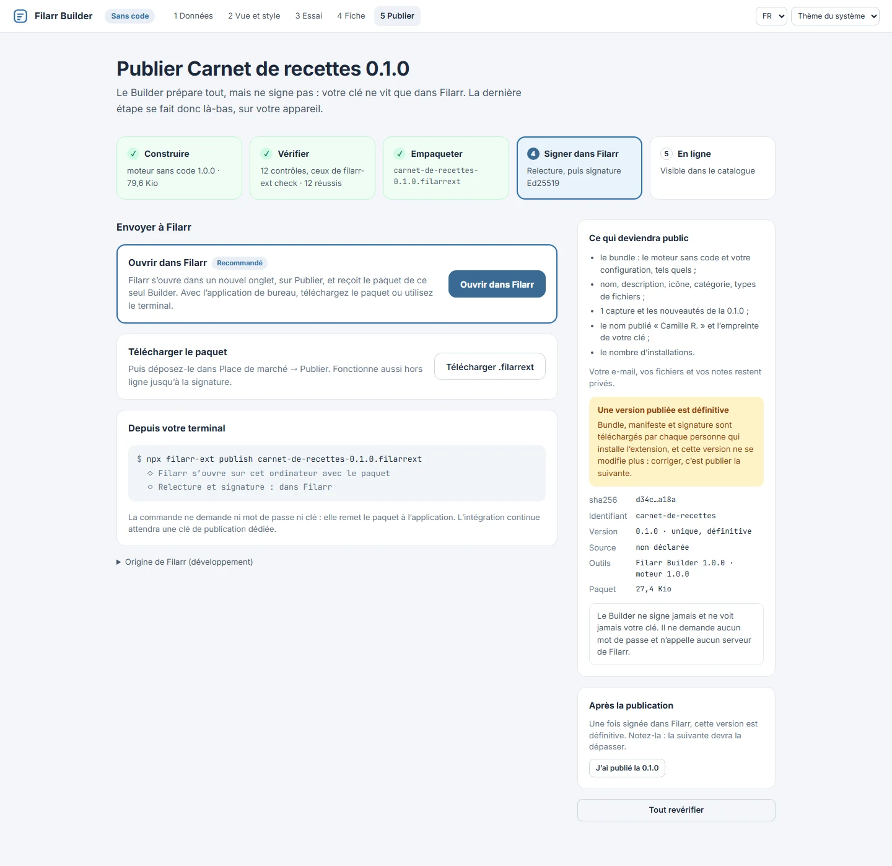
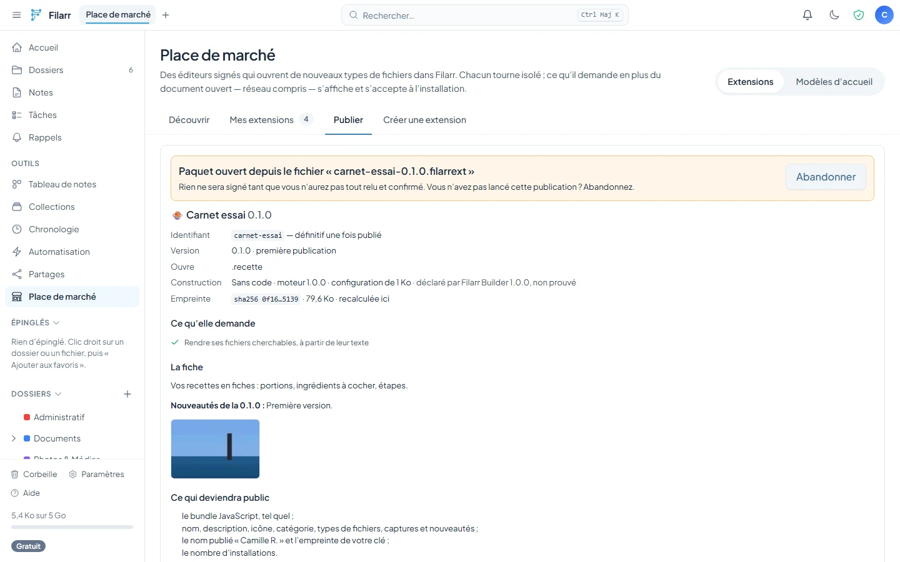

# Publishing an extension

Publishing means signing. This document states exactly what the server accepts, what your
key covers, and what is **permanent**.

Read it **before** your first publication: three decisions on this page cannot be
undone.

---

## 1. What is permanent — the three traps

| Decision                           | What happens if you get it wrong                                                                                                                                                  |
| ---------------------------------- | --------------------------------------------------------------------------------------------------------------------------------------------------------------------------------- |
| **The slug** (the manifest's `id`) | First come, first served, **permanently**. A taken slug answers `409 slug_taken`. There is no renaming, no release, no transfer. Choose it the way you would choose a domain name |
| **Each version**                   | Immutable. Republishing an existing version answers `409 version_exists`. You do not "fix" a `0.1.0`: you publish `0.1.1`                                                         |
| **Your account key**               | It is pinned on every user's device at first install. Changing it triggers a security warning for everyone (§5)                                                                   |

In practice: **start at `0.1.0`** and iterate in `0.x` with the "Test without publishing"
area (see [QUICKSTART.md](QUICKSTART.md), §4). You are allowed **10 publications per day
per account**; `1.0.0` has to be earned.

## 2. The manifest, field by field

It is a JSON object serialized **exactly once** (in Filarr, `buildManifestJson`). Those
bytes are the ones you sign, and they travel unchanged all the way to IndexedDB.

```json
{
  "id": "kanban",
  "name": "Kanban",
  "version": "0.1.0",
  "description": "Tableaux kanban hors ligne, format .kanban.",
  "extensions": ["kanban"],
  "bundleHash": "9f2c…",
  "publisherFingerprint": "01234 56789 01234 56789 01234 56789",
  "trust": "sandboxed",
  "icon": "🗂️",
  "category": "productivity"
}
```

| Field                  | Type        | Exact constraint (worker)                                                                     | Notes                                                                                                                                                                                   |
| ---------------------- | ----------- | --------------------------------------------------------------------------------------------- | --------------------------------------------------------------------------------------------------------------------------------------------------------------------------------------- |
| `id`                   | `string`    | `^[a-z][a-z0-9-]{1,63}$` — starts with a letter, 2 to 64 characters, lowercase/digits/hyphens | **This is the slug.** It must also match the URL of `POST /:slug/versions`, otherwise `bad_manifest`                                                                                    |
| `version`              | `string`    | `^\d+\.\d+\.\d+$`                                                                             | Three numbers, nothing else: no `v1.0.0`, no `1.0`, no `1.0.0-beta`                                                                                                                     |
| `trust`                | `string`    | **must be `"sandboxed"`**                                                                     | Any other value ⇒ `bad_manifest`. `builtin` means "reviewed like core code": a downloaded bundle never will be                                                                          |
| `name`                 | `string`    | 1 to 100 characters                                                                           | Shown in the catalog **and** as the label of the edit action                                                                                                                            |
| `description`          | `string`    | ≤ 2000 characters, **required field** (may be empty)                                          | Plain text. Rendered without HTML on the client                                                                                                                                         |
| `extensions`           | `string[]`  | 1 to 10 entries, each `^[a-z0-9]{1,10}$`                                                      | No dot, lowercase. A file extension already claimed by an active extension ⇒ `register_failed` at install                                                                               |
| `bundleHash`           | `string`    | `^[0-9a-f]{64}$`                                                                              | **Lowercase hex** sha256 of the bundle bytes. Verified on the server **and** on every client load                                                                                       |
| `publisherFingerprint` | `string`    | Must be **equal** to the fingerprint computed from your account key                           | 6 groups of 5 digits separated by spaces                                                                                                                                                |
| `icon`                 | `string?`   | Optional. **1 to 8 code points**, including **at least one pictograph**                       | Per-code-point allowlist: extended pictographic, U+FE0F, U+200D (ZWJ), skin tones U+1F3FB–U+1F3FF. Never `.length` (UTF-16 units would measure how the emoji is composed, not its size) |
| `category`             | `string?`   | Optional, one of `editors`, `productivity`, `data`, `media`, `fun`, `other`                   | Missing ⇒ shown as `other`                                                                                                                                                              |
| `author`               | `string?`   | Optional. Trimmed, non-empty, ≤ 80 code points, no invisible or bidirectional characters      | The published name, signed with the version. Proves nothing on its own: the listing page always shows it together with the fingerprint                                                  |
| `previews`             | `string[]?` | Optional. 4 at most, PNG, JPEG or WebP data URLs of 96 KiB at most                            | The screenshots, signed with the version. Never SVG                                                                                                                                     |
| `capabilities`         | `object?`   | Optional. Closed list and bounds from [CAPABILITIES.md](CAPABILITIES.md)                      | What the extension asks of the host, shown and accepted at install. An unknown key ⇒ `bad_manifest`                                                                                     |
| `releaseNotes`         | `string?`   | Optional. ≤ 2000 code points                                                                  | The release notes for THIS version, plain text                                                                                                                                          |
| `sourceUrl`            | `string?`   | Optional. `https://`, ≤ 300 characters, no spaces                                             | The link to the source code                                                                                                                                                             |
| `license`              | `string?`   | Optional. 1 to 40 characters, no control characters                                           | The declared license (MIT, Apache-2.0…)                                                                                                                                                 |

All fields marked `?` are **optional and backward-compatible**: a manifest that does not
carry them stays valid everywhere (publication, verification, loading). They travel
**inside** `manifestJson`, so they are covered by the same signature — nothing else
changes in the protocol.

> The defense against a hostile icon is not validation at publish time (the database
> column is not signed): it is the **rendering**, plain text, never HTML. The same rule
> applies to the name and the description.

### Size limits

| Object       | Cap                        | Where (in Filarr)                                                                           |
| ------------ | -------------------------- | ------------------------------------------------------------------------------------------- |
| Bundle       | **4 MiB** (and ≥ 1 byte)   | `MAX_PLUGIN_BUNDLE_BYTES` — `validatePublishBody`                                           |
| Manifest     | **640 KiB in UTF-8 bytes** | `MAX_MANIFEST_BYTES` — `validatePublishBody`                                                |
| Request body | 8 MiB                      | `MAX_PUBLISH_CONTENT_LENGTH` — `marketplace.ts` (a 4 MiB bundle is about 5.3 MiB in base64) |

The manifest is measured in **UTF-8 bytes**, not characters: `.length` would count UTF-16
units and let a bloated multi-byte manifest through.

## 3. The signature: who signs what, and why verbatim

### The signed bytes

```
UTF-8( "filarr.identity.sig.v1\n" + "filarr.plugin.manifest.v1\n" + manifestJson )
```

Two domain-separation prefixes, each with its own role:

- `filarr.identity.sig.v1\n` — prepended automatically by `signWithIdentity` (in Filarr,
  `userKeypair.ts`), shared by every identity signature in the product. It prevents a
  message signature from being mistaken for the signature that binds keys together;
- `filarr.plugin.manifest.v1\n` — the domain of extension manifests. It prevents a
  signature obtained elsewhere in the product from being replayed as a publication.

The worker rebuilds **both** before verifying (`buildPluginManifestSignedBytes`). On the
client, `signManifest` passes only the extension part — the identity domain is added by
the signing layer.

### Why verbatim

`manifestJson` is a **string** end to end: network, D1, IndexedDB, verification. Nobody
re-serializes it, anywhere.

This is an implementation constraint, not a nicety: key order, Unicode escaping and
whitespace are **bytes**, and bytes are what is signed. A single `JSON.stringify` that
reformatted the manifest somewhere along the chain would break every existing signature.
And parsing only happens **after** signature verification — otherwise a malicious JSON
would choose what the parser sees before the cryptography has had its say.

### Who signs, who verifies

| Step                           | Key used                                                                                        | Where                                        |
| ------------------------------ | ----------------------------------------------------------------------------------------------- | -------------------------------------------- |
| Signing                        | Your Ed25519 **private** key, in the device's memory, never transmitted                         | Filarr's **Publish** tab                     |
| Verification at publish        | **Your account's registered public key** (`db.getUserKey`), never a key supplied in the request | `marketplace.ts`, `validatePublishBody`      |
| Verification at install        | The key served by the API, **then pinned**                                                      | `installedPlugins.ts`, `installPlugin`       |
| Verification on **every load** | The key **pinned** in the local record                                                          | `installedPlugins.ts`, `verifyAndRegister`   |

The publisher ↔ account link is therefore structural: the server cannot accept a
publication signed by someone else, even if it wanted to.

### The validation pipeline, in order

`validatePublishBody` (in Filarr's worker, `marketplace.ts`). The order **is** the
security:

1. body shape `{manifestJson, signature, bundleBase64}` → `bad_request` (400);
2. manifest ≤ 640 KiB UTF-8 → `manifest_too_large` (413);
3. decodable base64, bundle between 1 byte and 4 MiB → `bundle_too_large` (413);
4. account key present, algorithm `x25519-ed25519` → `no_account_key` (400);
5. **Ed25519 signature** over the verbatim bytes → `bad_signature` (400);
6. `JSON.parse` → `bad_manifest` (400);
7. manifest shape (table above) → `bad_manifest` (400);
8. `sha256(bundle) === bundleHash` → `hash_mismatch` (400);
9. manifest fingerprint === account key fingerprint → `fingerprint_mismatch` (400).

Then, depending on the route: R2 **before** D1 (an orphan object is harmless; a row
pointing at nothing is not), creation (`slug_taken`, 409) or version addition
(`version_exists`, 409; slug not owned ⇒ **uniform 404** `plugin_not_found`, never an
existence oracle).

### Every possible refusal

| Code                   | HTTP | Cause                                                 | What to do                                                     |
| ---------------------- | ---- | ----------------------------------------------------- | -------------------------------------------------------------- |
| `bad_request`          | 400  | Malformed body, unreadable JSON, invalid base64       | Bug in the publishing tool                                     |
| `manifest_too_large`   | 413  | Manifest > 640 KiB UTF-8                              | Shorten the description                                        |
| `bundle_too_large`     | 413  | Empty bundle, > 4 MiB, or body > 8 MiB                | Minify, remove sourcemaps                                      |
| `no_account_key`       | 400  | No key pair on the account, or unsupported algorithm  | Settings → Encryption                                          |
| `bad_signature`        | 400  | The signature does not verify against the account key | **Trap #1 on the CLI**: wrong half of the private key (see §7) |
| `bad_manifest`         | 400  | Shape refused, or `id` ≠ slug in the URL              | Compare with the table in §2                                   |
| `hash_mismatch`        | 400  | `bundleHash` ≠ sha256 of the bundle sent              | Recompute the hash **after** the build                         |
| `fingerprint_mismatch` | 400  | `publisherFingerprint` ≠ the account's fingerprint    | Copy the fingerprint shown in the Publish tab                  |
| `slug_taken`           | 409  | Slug already taken                                    | Choose another one — permanent                                 |
| `version_exists`       | 409  | Version already published                             | Increment                                                      |
| `plugin_not_found`     | 404  | Unknown slug **or** not yours                         | Uniform response, on purpose                                   |
| `rate_limited`         | 429  | Quota reached                                         | See §4                                                         |

## 4. Quotas

| Action                                | Limit   | Window | Key                   |
| ------------------------------------- | ------- | ------ | --------------------- |
| Publish (creation **or** new version) | **10**  | 24 h   | `mkt-pub:<userId>`    |
| Download a bundle                     | **300** | 1 h    | `mkt-dl:<userId>`     |
| List the catalog                      | 600     | 1 h    | `mkt-list:<userId>`   |
| Report an extension                   | 5       | 24 h   | `mkt-report:<userId>` |

Quotas are **per account**, not per extension. Ten publications a day cover an honest
release day and make published iteration impossible — that is the point.

## 5. TOFU: what the installing user sees

_Trust on first use._ At first install, the client **pins** the publisher's public
signing key in the local record (`pinnedSignPublicKey`). Every later verification —
installing an update, and every application load — is done against **that key**, never
against a key the server might serve again.

If an update is signed by a different key, installation is refused with
`publisher_key_changed` and the user sees this:

> **A different key signed this update**
> The update for <name> is signed by another key than the one you trusted when you
> installed it. Either the author changed their signing key on purpose, or someone else
> took control of their publishing account. Filarr cannot tell the two apart — only the
> author can.
> Key you trusted: … / Key offered now: … — **Keep my version** · **Trust the new key**

Only an explicit action re-pins (and accepting is remembered: later updates signed by the
new key install without asking). There is **no** silent overwrite.

**What this means for you, as a publisher**: never change your account's key pair without
announcing it publicly, in advance, through a channel your users can cross-check
(website, repository, social network). Otherwise your update will look exactly like an
attack — because nothing, technically, tells them apart.

The fingerprint is the **6 groups × 5 digits** rendering of the SHA-256 of your public key
(`computeFingerprint` in Filarr; server-side mirror: `computePublisherFingerprint` in the
worker). Publish it next to your extension: it can be compared by reading it aloud.

## 6. Anti-rollback and unpublishing

**Anti-rollback.** Installing a version _lower_ than the one already installed is refused
(`version_rollback`) unless the user explicitly chooses to: a compromised server cannot
push a vulnerable version disguised as an "update". Reinstalling the **same** version is
still allowed — it is how a broken record gets repaired.

What this means for you: you do not "roll back" by republishing the old code under the
old number (impossible: `version_exists`). A rollback is a **new, higher version**
containing the old code.

**Unpublishing.** `DELETE /marketplace/:slug` sets the status to `unlisted` (route
`DELETE /:slug`): the extension disappears from the public catalog, stays visible to you,
and — this is the point — **nothing is deleted**. Neither the R2 object nor the version
rows. Users who installed it must be able to keep re-verifying their copy on every load
and to reinstall it. Bundle downloads are, in fact, still served for **every** existing
version, whatever the status (route `GET /:slug/versions/:version/bundle`).

There is no hard delete. This is deliberate: it would turn every unpublication into an
outage for users.

## 7. Publishing a package, from the Builder or the terminal

The **Publish** tab accepts a `.filarrext` package (format: [PACKAGE.md](PACKAGE.md)),
produced by Filarr Builder or by `filarr-ext pack`. The package carries the bundle, the
**unsigned** manifest, the listing page and the screenshots — and neither key nor
signature.

Three ways to hand it over, one single flow afterwards:

- drop it into **Publish** (desktop and web);
- `npx @filarr/extension-cli publish mon-extension-1.0.0.filarrext` (in a project where
  it is installed, `npx filarr-ext publish` is enough): opens the desktop app on Publish
  with the package (`filarr://publish`). The command asks for **neither password nor
  key**;
- **Open in Filarr** from the Builder, in the browser: Filarr opens in a new tab and
  receives the package.



In every case, Filarr first shows the provenance and **Abandon**, then everything that
will become public (identity, version and the key of the previous one, file types,
requested capabilities, recomputed bundle hash, configuration difference for a no-code
extension). The "I have reviewed everything." checkbox is required before **Sign and
publish**, and signing happens on the device.



### Why there is no automated publishing with the account key

The key that signs an extension is the **account's** identity key: the same key unlocks
your vaults. Putting it in continuous integration (environment variable, repository
secret) or unwrapping the private key with your password in a script means exposing your
vaults to anyone who can read that secret. Hence the rule: prepare the package anywhere,
sign only in Filarr. A **dedicated** publishing key, safe to use in continuous
integration, would require a new route and a migration: it does not exist yet.

The old `scripts/publish.mjs` script in the [`filarr-plugin-kanban`](https://github.com/matbel91765/filarr-plugin-kanban) repository, which
unwrapped the private key from the password, must no longer be used as a model.

---

**See also**: [ARCHITECTURE.md](ARCHITECTURE.md) §5 for the complete supply-chain trust
model, [QUICKSTART.md](QUICKSTART.md) §6-8 for step-by-step publishing from the app.
