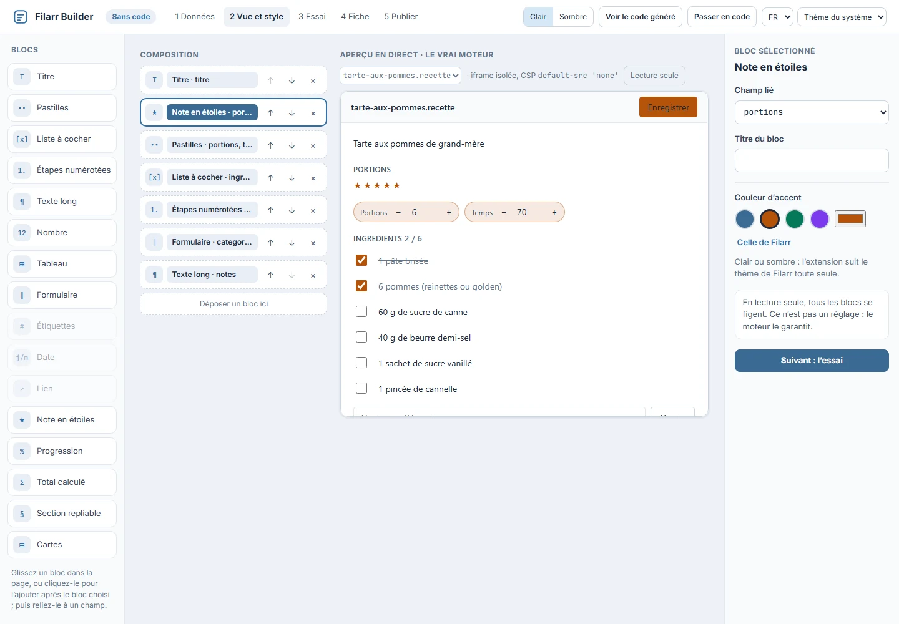

# Quickstart — from zero to installed

This page builds a **complete** extension: a word counter that edits `.wc` files.
About 70 lines, no dependencies, compliant with the contract in `API.md`. By the end, it
will be published on the marketplace and installed in your app.

Allow twenty minutes.

---

## The shortest path: the Builder's tools

This public repository, **`filarr-extension-builder`**, does everything this page does by hand:

```bash
npm create filarr-extension@latest compteur-mots   # a ready project: manifest, src/, exemples/
cd compteur-mots
npm install             # installs filarr-ext in the project
npx filarr-ext dev      # the simulator: the same isolation as Filarr, reloaded on every save
npx filarr-ext check    # the server's and Filarr's checks, before you spend a version
npx filarr-ext pack     # dist/compteur-mots-0.1.0.filarrext
npx filarr-ext publish dist/compteur-mots-0.1.0.filarrext   # opens Filarr on Publish
```

`npx filarr-ext` only works once the project is installed: outside a project (a package
downloaded from Filarr Builder), use `npx @filarr/extension-cli <command>`. Every command
and every check is detailed in [`docs/cli.md`](../cli.md).

**No-code**: `npm create filarr-extension@latest my-recipes -- --template nocode`
creates a project whose editor is a configuration (`nocode.json`: format, fields,
blocks, color) read by the no-code engine. The full schema is in [`docs/nocode.md`](../nocode.md),
and ten no-code examples are in [`examples/nocode/`](../../examples/nocode/). Filarr Builder,
the in-browser workshop, composes this configuration with the mouse.



The same flow exists in the app: **Marketplace → Create an extension**.


Publishing always goes through Filarr: the package carries no key and no signature, you
review everything that will become public, then Filarr signs on your device
([PACKAGE.md](PACKAGE.md), [PUBLISHING.md](PUBLISHING.md) §7). It is also the only path
that publishes **capabilities** ([CAPABILITIES.md](CAPABILITIES.md)): the manual wizard
in the Publish tab does not sign them.

The rest of this page walks the same path without any tools, to show what lies underneath.

## 0. Prerequisites

- Node 18+ (only for `esbuild` — the extension itself has no dependencies);
- a Filarr account with an **unlocked keypair** (Settings → Encryption). The private
  key signs the manifest, on your machine, and never leaves it;
- the Filarr app open (web or desktop, either one).

## 1. The skeleton

```
filarr-plugin-wc/
├── src/index.js
└── package.json
```

```json
{
  "name": "filarr-plugin-wc",
  "private": true,
  "scripts": {
    "build": "esbuild src/index.js --bundle --format=iife --target=es2020 --minify --outfile=dist/wc.plugin.js"
  },
  "devDependencies": { "esbuild": "^0.23.0" }
}
```

`--format=iife` is not decorative: the bundle is executed as a **function body**
(`new Function('globalThis', code)`), where `import`/`export` are syntax errors.
An ESM bundle gives `sandbox_no_plugin` at mount time.

## 2. The extension, in full

`src/index.js`:

```js
// "Word counter" extension — edits .wc files (plain UTF-8 text).
(() => {
  const enc = new TextEncoder();
  const dec = new TextDecoder();
  const AUTOSAVE_MS = 2000; // never less: every save encrypts and pushes

  const ERREURS = {
    item_version_conflict: 'Conflict — someone else saved. Save again to overwrite.',
    read_only: 'Read-only — your changes will not be saved.',
    save_in_flight: 'Already saving…',
  };

  const compter = (texte) => (texte.match(/\S+/g) || []).length;

  function mount(host) {
    host.container.textContent = ''; // the host owns this node; never innerHTML

    const wrap = document.createElement('div');
    wrap.style.cssText =
      'display:flex;flex-direction:column;height:100%;color-scheme:light dark;' +
      'font:13px system-ui;background:Canvas;color:CanvasText';

    const barre = document.createElement('div');
    barre.style.cssText =
      'display:flex;gap:12px;padding:6px 10px;border-bottom:1px solid rgba(128,128,128,.35)';
    const compteur = document.createElement('span');
    const etat = document.createElement('span');
    etat.style.cssText = 'opacity:.7';
    barre.append(compteur, etat);

    const zone = document.createElement('textarea');
    zone.style.cssText =
      'flex:1;border:0;outline:none;padding:10px;resize:none;' +
      'font:14px/1.5 monospace;background:transparent;color:inherit';
    zone.value = dec.decode(host.initialBytes); // 0 bytes = new document, the normal case
    zone.readOnly = host.readOnly; // readOnly is an obligation

    let minuteur = null;
    const rafraichir = () => {
      compteur.textContent = compter(zone.value) + ' words';
    };

    const enregistrer = () => {
      minuteur = null;
      etat.textContent = 'saving…';
      host.saveBytes(enc.encode(zone.value)).then(
        () => {
          etat.textContent = 'saved';
          host.onDirty(false);
        },
        // We STAY dirty: the rejection carries a stable code, not a translated sentence.
        (e) => {
          etat.textContent = ERREURS[e.message] || 'failed (' + e.message + ')';
        }
      );
    };

    zone.addEventListener('input', () => {
      rafraichir();
      if (host.readOnly) return;
      host.onDirty(true); // on EVERY mutation, not just the first
      etat.textContent = 'modified';
      if (minuteur) clearTimeout(minuteur);
      minuteur = setTimeout(enregistrer, AUTOSAVE_MS);
    });

    const clavier = (e) => {
      if ((e.ctrlKey || e.metaKey) && e.key === 's') {
        e.preventDefault();
        if (host.readOnly) return;
        if (minuteur) clearTimeout(minuteur);
        enregistrer();
      }
    };
    wrap.addEventListener('keydown', clavier);

    wrap.append(barre, zone);
    host.container.appendChild(wrap);
    rafraichir();

    return {
      destroy() {
        if (minuteur) clearTimeout(minuteur); // the debounce does not outlive unmounting
        wrap.removeEventListener('keydown', clavier);
        wrap.remove();
      },
      getBytes() {
        return enc.encode(zone.value);
      }, // complete, bounded, synchronous
    };
  }

  const ids = ['wc-editor']; // the published id: <slug>-editor, slug "wc"
  for (let i = 1; i <= 8; i++) ids.push('dev-local-' + i + '-editor'); // local testing
  globalThis.filarrSandboxedPlugin = { editors: ids.map((id) => ({ id, mount })) };
})();
```

What these 70 lines already cover of the contract:

- `id` **exactly** `wc-editor` (the slug will be `wc`) — plus the local-testing aliases;
- `initialBytes` read once, after which the `<textarea>` is the source of truth;
- `readOnly` propagated to the field **and** honored before any `saveBytes`;
- `onDirty(true)` on every keystroke, `onDirty(false)` only after a success;
- autosave debounced at 2 s, `Ctrl`/`Cmd`+`S` to force it;
- rejections mapped **by code** (`item_version_conflict`, `read_only`, `save_in_flight`);
- `getBytes()` synchronous and complete; `destroy()` that cancels the timer.

What a real extension still needs, and has nothing to do with the contract: i18n,
undo/redo, keyboard accessibility beyond the field, tests of the model. See
[`filarr-plugin-kanban`](https://github.com/matbel91765/filarr-plugin-kanban).

## 3. Build

```bash
npm install && npm run build
```

Result: `dist/wc.plugin.js`, a few kilobytes. The ceiling is 4 MiB; add a size guard
to your script (the kanban repository fails above 1 MiB — a 4× margin).

## 4. Test locally — without burning a version

Published versions are **immutable** and you get 10 publications per day.
So you do not iterate by publishing.

1. Filarr → **Marketplace** → **Publish** tab → **“Test without publishing”** area;
2. choose `dist/wc.plugin.js` — or a `.filarrext` package, whose name, types and
   capabilities are read; the capabilities are shown and granted for the session
   only;
3. extensions: `wc`;
4. confirm: the extension appears in **My extensions** with a **session** badge.

This path is safe by construction — it is the same sandbox, the same CSP, the same
bridge. It differs on only three points: nothing is written to IndexedDB, there is no
signature and no verification (the code comes from your disk), and **everything is gone
when the page reloads**.

This is what the `dev-local-<n>-editor` aliases are for: the synthetic manifest of the local
test does not have your slug, so the host asks for a different `editorId`. Without the aliases,
the banner shows `sandbox_editor_not_found`.

> The old `filarr-plugin-sandbox-demo` flag is **not** a testing path: it only loads the
> core's demo notepad and its isolation self-test. Useful for checking the environment,
> useless for your code.

## 5. Create a `.wc` file

An extension with no file to open cannot be tested. In a vault:

**New document** (next to “New folder”) → one entry per registered extension
→ `wc` → give it a name.

The host creates a **0-byte** file in the current folder and immediately opens
your editor. That is why `API.md` insists: an empty document is a normal case, not
an error.

Then check, in order: the counter shows `0 words`; typing sets the status to
`modified`; two seconds later, `saved`; closing and reopening shows the text;
in read-only mode (guest account of a shared vault), the field is locked.

## 6. Publish

When the extension holds up — and not before. See `PUBLISHING.md` for the exact
constraints on each field.

Marketplace → **Publish** tab:

| Field             | Value for this example | Constraint                                                        |
| ----------------- | ---------------------- | ----------------------------------------------------------------- |
| Bundle            | `dist/wc.plugin.js`    | ≤ 4 MiB                                                           |
| Identifier (slug) | `wc`                   | `^[a-z][a-z0-9-]{1,63}$` — **permanent, first come first served** |
| Name              | `Word counter`         | 1 to 100 characters                                               |
| Description       | one sentence           | ≤ 2000 characters                                                 |
| Version           | `0.1.0`                | `^\d+\.\d+\.\d+$` — **immutable**                                 |
| File extensions   | `wc`                   | 1 to 10, `^[a-z0-9]{1,10}$`                                       |

Start at **`0.1.0`**: the slug and every version are permanent; `1.0.0` has to be
earned.

On click, in this order: sha256 of the bundle → construction of the `manifestJson` (**a single**
`JSON.stringify`) → Ed25519 signature over the exact bytes, with your local key →
`POST /marketplace` with `{manifestJson, signature, bundleBase64}`. The worker re-verifies
the signature **against the key registered to your account** — never against a key from the
request body.

Your publisher fingerprint (6 groups of 5 digits) is shown above the
form: it is what your users will see at install time, and what they will have to
compare if your key ever changes.

## 7. Install

**Discover** tab → your extension → **Install**.

What the client does, without relying on any promise from the server: downloads the
bundle, verifies the signature, `sha256(bundle) === bundleHash`, `manifest.id ===
requested slug`, `manifest.version === requested version`, fingerprint, `trust === 'sandboxed'`
— then **pins the publisher's key** (TOFU) and writes to IndexedDB.

Every time the app starts, everything is **re-verified**. A bundle tampered with in the local
database gets the status `broken_signature`: nothing mounts, and the interface offers to
reinstall.

Open a `.wc`: your editor opens in the modal, this time for real.

## 8. Update

1. fix, `npm run build`;
2. test through “Test without publishing” (again);
3. bump the version — `0.1.1`. **Republishing `0.1.0` is refused** (`version_exists`);
4. Publish → the form detects that the slug is yours and posts to
   `/marketplace/wc/versions`;
5. your users see a badge on the Marketplace entry; **My extensions**
   lists the update with its release notes, and **Update** is also on the listing.

   

Three refusals will come your way sooner or later, and they are intentional:

- **`version_exists`** — a published version is set in stone. Bump it.
- **`slug_taken`** — the slug belongs to someone else, permanently.
- **`rate_limited`** — 10 publications per day per account. Iterate locally.

And for your users' sake: **never** change your account key without announcing it. An
update signed by another key triggers the “A different key signed this update” screen,
which talks about a compromised account — and is right to do so.

---

**Next**: `API.md` for the exact semantics of each field, `PUBLISHING.md` for
publishing in detail. From a terminal, `npx filarr-ext pack` then `npx filarr-ext publish`:
the package is still signed in Filarr ([PUBLISHING.md](PUBLISHING.md) §7).
