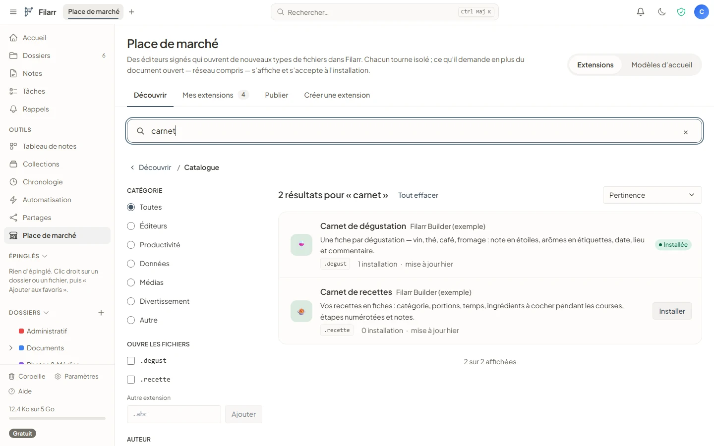
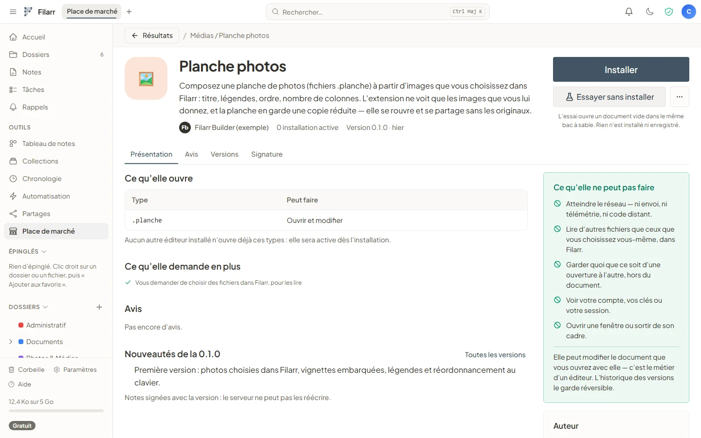
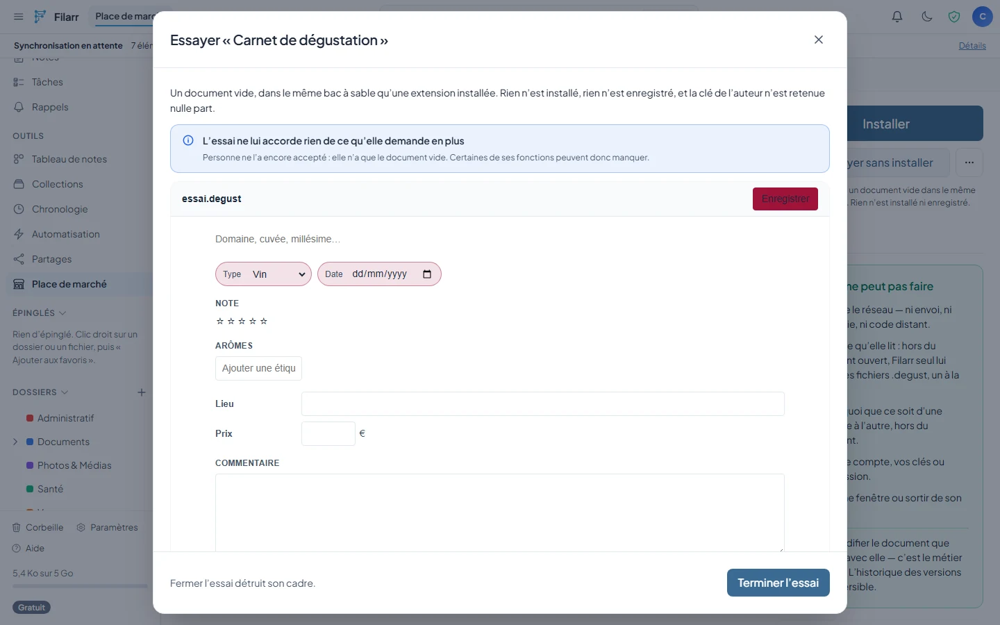
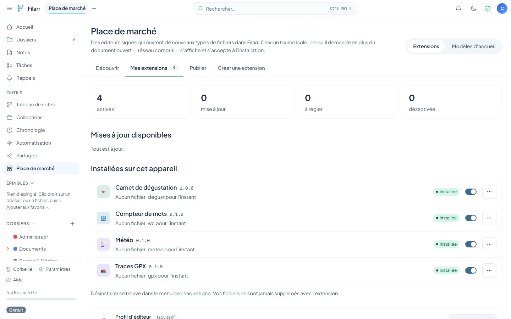
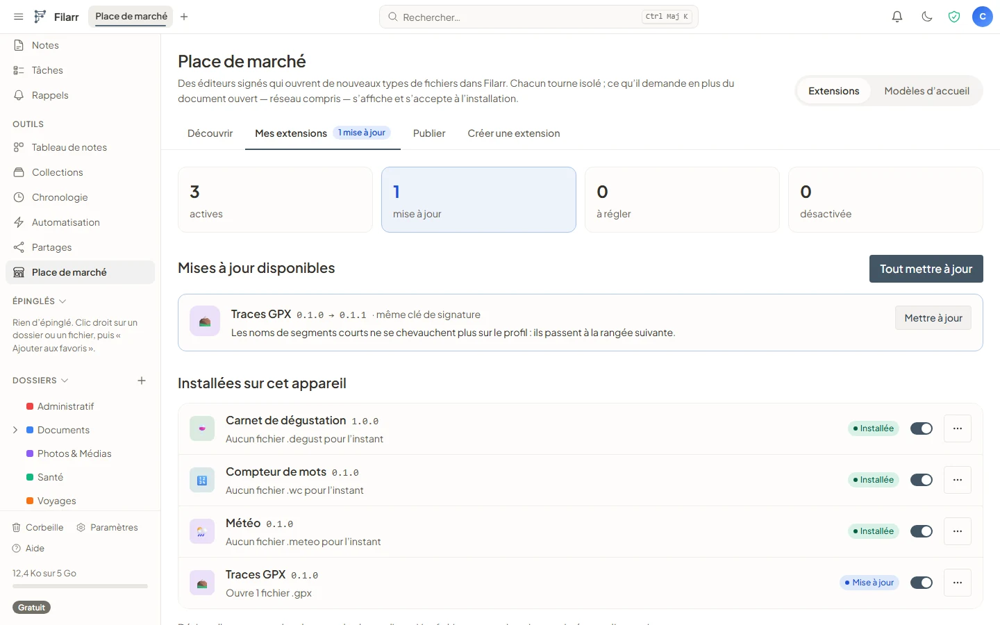
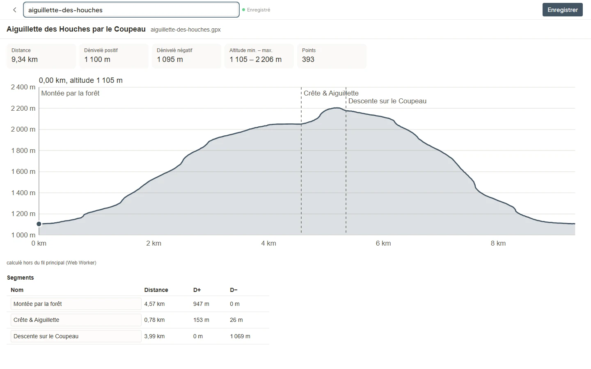

# Building a Filarr extension

This English contract is the public reference for Filarr extensions. It is maintained in
this repository, `filarr-extension-builder`, alongside the tools and examples that
implement it.

This documentation is for anyone who wants to write a Filarr **extension**: a file
editor, distributed through the marketplace, that opens a format Filarr does not know
— with code, or without writing a single line.

It describes the actual contract, as implemented. Where it helps, it names the Filarr
file that enforces a rule.

---

## What an extension is

A **single JavaScript bundle** (IIFE) that sets a global object:

```js
globalThis.filarrSandboxedPlugin = {
  editors: [
    {
      id: 'compteur-mots-editor',
      mount(host) {
        /* … */ return instance;
      },
    },
  ],
};
```

This bundle **never** runs inside the app. It is downloaded, verified
(its author's Ed25519 signature, the file's fingerprint), stored as a **string**, then
executed in an **opaque-origin iframe** whose page carries its own
`default-src 'none'` CSP (`plugin-sandbox.html` in Filarr). The host passes it the
**decrypted bytes of one document** over a private `MessagePort`. Encryption, the version
lock, sync and the co-editing room stay with Filarr.

## What it receives, and what it can ask for

By default, an extension receives **only the open document**. It can **ask** for
more in its signed manifest — and every request is shown and accepted at
install time ([CAPABILITIES.md](CAPABILITIES.md)):

| Capability                           | What it unlocks                                                                          |
| ------------------------------------ | ---------------------------------------------------------------------------------------- |
| `newDocument`, `maxBytes`, `imports` | “New document”, larger files, importing other formats                                    |
| `storage`                            | its own data, encrypted, on the device                                                   |
| `functions`                          | making its files searchable, thumbnails, a table, exports — in a page with no API at all |
| `picker`                             | asking for files: it only sees the ones you tick                                         |
| `noteBlock`, `homeWidget`            | a block in notes, a home block                                                           |
| `collab`                             | live editing with others, in a shared vault                                              |
| `network`                            | Internet access to declared domains only, each request shown before it leaves (desktop)  |

Two rules hold it all together: an extension never chooses what it sees, and never
reads your files AND talks to the Internet without you (`network` excludes `picker`,
`storage`, `functions` and `noteBlock`). An organization can forbid capabilities,
restrict domains and authors (organization rules, same document).

## With code, or without

- **With code**: TypeScript or JavaScript, the UI library of your choice.
  `npm create filarr-extension@latest` creates a ready project; after `npm install`, `npm run dev` opens the
  simulator (the same isolation as Filarr), `npm run check` runs the server's
  checks, `npm run pack` produces the `.filarrext` package.
- **No-code**: describe your file (JSON, CSV, lines, `key: value`), place
  blocks, set the style. The no-code engine — the same for all extensions, audited — reads, displays
  and writes back your format without ever executing anything it reads.

Both go through this repository, **`filarr-extension-builder`**: the typed API
(`@filarr/extension-api`), [the no-code engine](../nocode.md), the simulator, [the commands](../cli.md)
(`filarr-ext`) and [the in-browser workshop](../workshop.md) (Filarr Builder).

## The marketplace in pictures

Screenshots of the web version on a local test bench (test worker, fictitious account), with
the Builder's examples published.

**Discover**: categories, most installed, new this month. Search also covers
file types (`.gpx`, `.epub`…).


**The catalog**: filters by category, by file type opened and by author.



**The listing**: what the extension opens, what it asks for beyond the document, and what
it cannot do. **Try without installing** opens an empty document in the same
sandbox, without installing or saving anything, and without granting any capability.





**Consent**: every requested capability is shown and accepted at install time
([CAPABILITIES.md](CAPABILITIES.md)). Here, Météo (a weather extension) asks for a home
widget and Internet access to a single domain.


**My extensions**: the state of each installed extension. An update shows its
release notes and says whether the key that signs it is the same.





**An extension at work**: Traces GPX opens a hiking track imported into
a folder (elevation profile navigable from the keyboard, computed in a Web Worker).



**Publishing** a package and **Create an extension**:
[PUBLISHING.md](PUBLISHING.md) §7 and [QUICKSTART.md](QUICKSTART.md). **Organization
rules**: [CAPABILITIES.md](CAPABILITIES.md).

## Map of the documents

| Document                             | What you will find                                                                     | Read it when                                                 |
| ------------------------------------ | -------------------------------------------------------------------------------------- | ------------------------------------------------------------ |
| [QUICKSTART.md](QUICKSTART.md)       | From zero to installed: a complete extension, local testing, publishing                | The first time                                               |
| [API.md](API.md)                     | The guest contract: `mount(host)`, every field of `host`, capabilities, errors, limits | While writing                                                |
| [CAPABILITIES.md](CAPABILITIES.md)   | Capabilities, their protocol, their bounds, and organization rules                     | Before asking for more than the document                     |
| [PACKAGE.md](PACKAGE.md)             | The `.filarrext` package and how it is handed to Filarr                                | To publish from the Builder or the terminal                  |
| [PUBLISHING.md](PUBLISHING.md)       | The manifest field by field, signing, TOFU, immutability, quotas                       | Before publishing — **publishing takes preparation**         |
| [REVIEWS.md](REVIEWS.md)             | Reviews and active installs                                                            | To understand what the listing shows                         |
| [ARCHITECTURE.md](ARCHITECTURE.md)   | The end-to-end trust model, the bridge, the supply chain                               | Before writing code — it is the “why” behind the constraints |
| [COLLAB-DESIGN.md](COLLAB-DESIGN.md) | Co-editing for extensions: what is guaranteed, and what is not                         | Before asking for `collab`                                   |

## The examples

Twenty example extensions live in [`examples/`](../../examples/): ten with
code, ten no-code. Each one shows one specific thing, and all of them handle read-only mode,
the new document, Filarr's theme, French and English.

| Example              | Shows                                                  | Built with |
| -------------------- | ------------------------------------------------------ | ---------- |
| `compteur-mots`      | the quickstart, minimal                                | code       |
| `pense-bete`         | `storage` for display preferences                      | code       |
| `traces-gpx`         | a `blob:` worker, `thumbnail`, `fields`, `extractText` | code       |
| `croquis`            | `newDocument`, `maxBytes`, `thumbnail`, `exports`      | code       |
| `tableau-blanc`      | `collab`: live co-editing with Yjs                     | code       |
| `meteo`              | `network` to one domain, and `homeWidget`              | code       |
| `depots-github`      | `network` with a secret entered in Filarr              | code       |
| `compte-a-rebours`   | `noteBlock`                                            | code       |
| `sous-titres`        | `imports`, `extractText`, `exports`                    | code       |
| `planche-photos`     | `picker`: images chosen in Filarr                      | code       |
| `carnet-recettes`    | JSON, chips, checklist, steps; `extractText`, `fields` | no-code    |
| `fiche-contact`      | `key: value`, links                                    | no-code    |
| `liste-courses`      | checkable lines                                        | no-code    |
| `suivi-habitudes`    | CSV as a table                                         | no-code    |
| `journal-lecture`    | statuses and star ratings                              | no-code    |
| `inventaire`         | editable table, computed total, CSV export             | no-code    |
| `carnet-degustation` | ratings, tags, dates                                   | no-code    |
| `glossaire`          | list of definitions                                    | no-code    |
| `planning-semaine`   | one section per day                                    | no-code    |
| `fiche-personnage`   | stats, bars, `newDocument`                             | no-code    |

## Rules to adopt as they are

- **Document content is hostile.** A shared vault can contain another member's
  file; a file may have been crafted. Never `innerHTML` with document
  content, never `eval` on what you just read.
- **Lenient reading, strict writing.** Empty file → new document; unknown format
  → error displayed, **never** a silent overwrite.
- **Signing happens only in Filarr.** The key that signs an extension is the account key, the
  same one that unlocks vaults: it goes neither into a script nor into
  continuous integration ([PUBLISHING.md](PUBLISHING.md), §7).

## Vocabulary

The word is **extension** in the interface and in this documentation. Filarr's code,
including some contract identifiers (`filarrSandboxedPlugin`), still often says
“plugin”: they are the same objects.
